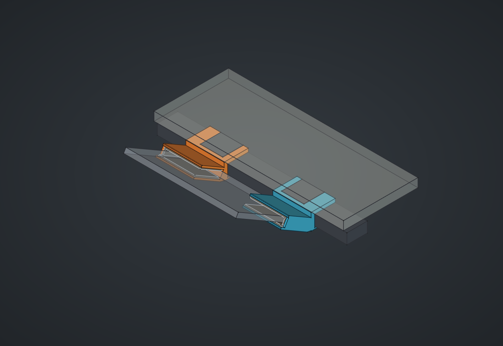

# Держатель ноутбука у края стола

Примерочная модель двух зеркальных держателей из PETG для Elegoo Neptune 4 Pro. Окружение построено первым: перекладина, верхние проставки, нижние пластины, крепёж, столешница и условный ноутбук. По [эскизу пользователя](references/layout_sketch.jpg) два П-профиля непосредственно соединены общей силовой стенкой: паз ноутбука находится на уровне обхвата перекладины, а не подвешен снизу. Держатель обхватывает перекладину и нижнюю пластину, крепится двумя болтами снизу и принимает переднюю часть основания ноутбука под 30°.

На каждом держателе добавлена одна наружная щека; со стороны середины ноутбука паз открыт. Верхняя полка и стенка обхвата усилены по указанию пользователя, нижняя полка под болтами оставлена толщиной 4 мм.

Наружная боковая грань щеки, ноутбучных полок, общей стенки и обхвата перекладины лежит в одной плоскости. Обхват расширен наружу до этой грани, без перемещения осей болтов и прорези под проставку. Эта плоскость служит основанием при печати; левый и правый STL повёрнуты каждый своей наружной гранью на Z=0.

Основной файл: [LaptopDeskMount.FCStd](LaptopDeskMount.FCStd). Открыт в FreeCAD. В дереве есть отдельные группы окружения, держателей, войлока и пробника. Экран ноутбука по умолчанию скрыт, чтобы были видны держатели. Все размеры в миллиметрах.



## Размеры и допущения

| Параметр | Значение | Основание |
|---|---:|---|
| Профиль ноги и перекладины | 60,21 × 30,48 | Фото; пользователь подтвердил одинаковый профиль |
| Зазор до столешницы | 10,51 | Фото 1000005532 |
| Ширина верхней проставки вдоль перекладины | 66,00 | Фото 1000005535, перечитано в правильной ориентации |
| Нижняя пластина: толщина | 3,21 | Фото 1000005534 |
| Столешница: толщина | 25,73 | Считывание фото 1000005540 |
| Между центрами узлов крепления | ≈240 | Приблизительный замер пользователя |
| Ноутбук: ширина / толщина основания | ≈332 / 14 | Пользователь / фото 1000005541 |
| Угол основания | 30° | Задан пользователем |
| Верхний / нижний захват | 75 / 85 | Верхний — предел до клавиатуры; нижний выбран конструктивно |
| Начало вентиляции | 92 от переднего края | Со слов пользователя; опора заканчивается на 7 мм раньше |
| Войлок | 4 сверху, снизу и у наружной щеки | Сжатие и толщина клея не моделировались |
| Паз ноутбука | 22,6 | 14 + 4 + 4 + 0,6 общего зазора |
| Масса ноутбука | до 1,3 кг | По документации пользователя; без работы на его клавиатуре |
| Ширина обхвата / ширина ноутбучной части | 113 / 113 | Общая плоская наружная грань для печати |
| Силовая стенка обхвата | 10,51 | По указанию пользователя, равна высоте доступного зазора |
| Силовая верхняя полка обхвата | 9,71 | Максимум в зазоре 10,51: по 0,4 мм сверху и снизу |
| Нижняя полка под болтами | 4 | По указанию пользователя оставлена прежней толщины |
| Полки ноутбука / наружная щека | 5 / 5 | Конструктивный выбор, испытания ещё не проводились |
| Боковой запас после войлока | 10 на сторону | Приблизительная ширина ноутбука не требует посадки впритык |
| Прорезь под проставку | 66,6 | 66 + 0,6 суммарного запаса |
| Два отверстия снизу | 7,5 × 12, продолговатые | Под предполагаемые M6, запас на примерку |

Общая стенка задана размерным эскизом в сечении и выдавлена по ширине обхвата. Дополнительного нижнего выноса между пазами нет. Передний край ноутбука по высоте центрирован относительно перекладины с нижней пластиной. При изменении толщин и угла положение ноутбука и общая стенка пересчитываются.

Ниже перечислены именно **оценки**, а не подтверждённые измерения. В таблице `Parameters` они выделены жёлтым:

- Ширина нижней пластины вдоль перекладины — 86; её глубина принята равной ширине профиля, положение — симметричным. Контур пластины по фото оценочный.
- Межосевое болтов — 36,51, рабочая трактовка фото 1000005547. Это не подтверждение точного положения отверстий. Пазы допускают подстройку вдоль линии двух болтов.
- Резьба M6 и длина болта 45 под головкой — допущения. Диаметр головки 13,65 и высота 1,70 взяты с фото. В модели болты показаны без резьбы; наличие зацепления реального крепежа геометрически не подтверждено.
- Общий стол 1400 × 700, высота 740, свес 10, удалённые связи и ноги — иллюстрация. Глубина ноутбука 220, геометрия и открытие экрана тоже условные.
- Точное положение ноутбука восстановлено по схеме: `FrontY` и `FrontZ` содержат выражения для непосредственного соединения двух П-профилей. Боковой запас `SideSlack` выбран 10 мм на сторону после войлока; его можно изменить в таблице. После изменения положения и габаритов проверять связность и зазоры.

## Файлы для примерки и печати

| Файл в `exports/` | Назначение | Габариты в ориентации STL, X × Y × Z |
|---|---|---:|
| `clamp_fit_sample.stl` | Только усиленный обхват перекладины с прорезью и двумя отверстиями | 48,20 × 71,52 × 113 |
| `holder_left.stl` | Левый держатель целиком | 72,43 × 161,81 × 113 |
| `holder_right.stl` | Правый держатель целиком | 72,43 × 161,81 × 113 |

Рядом лежат STEP тех же деталей. Все экспорты — отдельные тела, без стола, ноутбука и войлока. После изменения параметров они автоматически не обновляются.

Сначала напечатать **пробник обхвата**, проверить надевание на перекладину, прорезь вокруг проставки, охват нижней пластины и совпадение обоих отверстий. Обхват надевается с внешней стороны стола; прорезь открыта в сторону проставки. Для окончательной установки болты придётся снять и поставить через печатную нижнюю полку.

Под головками добавляется полка 4 мм; в сборке есть ещё 0,4 мм посадочного зазора. Достаточность длины штатных болтов проверяется при примерке. Уменьшать зацепление резьбы вслепую нельзя; длина замены определяется после доступа к крепежу. Это пока примерочный проект, без физического испытания под нагрузкой и без расчёта ползучести PETG.

STL уже повёрнуты на бок, общая наружная плоскость щеки и обхвата лежит на столе принтера. Ступеньки между щекой и обхватом нет. У прорези под проставку остаётся нависающая перемычка: проверить предпросмотр слоёв и добавить локальные поддержки. На контактные с ноутбуком поверхности войлок наклеивается после удаления поддержек. Параметры температуры и скорости брать из своего проверенного профиля PETG. G-code не создавался.

Габариты каждого STL помещаются в рабочий объём [Neptune 4 Pro 225 × 225 × 265 мм](https://www.elegoo.com/collections/3d-printing/products/elegoo-neptune-4-pro-fdm-3d-printer). Наличие поддержек и каймы также проверять в слайсере.

Размеры шести войлочных накладок в текущей модели: две верхние **106 × 72 × 4**, две нижние **106 × 82 × 4**, две боковые **72 × 14 × 4**. Это плоские заготовки; запас у входных скруглений уже оставлен. После бокового войлока между щёками остаётся 352 мм, то есть по 10 мм запаса для ноутбука шириной около 332 мм. Первую примерку делать с наклеенным войлоком.

## Работа в FreeCAD

`Parameters` — общая таблица замеров и конструктивных параметров. Окружение построено нативными примитивами, левый держатель — последовательностью нативных `PartDesign` операций с выражениями, правый — зависимым зеркалом. Сторонние Python-модули или FeaturePython-прокси для открытия и пересчёта не нужны. Пробник связан с промежуточной операцией обхвата и тоже обновляется.

Толщины разделены: `ClampWall` — наружная силовая стенка, `ClampTop` — верхняя силовая полка, `ClampShelf` — нижняя полка под болтами. `ClampTop = SpacerHeight - 2 × BeamClearance`, поэтому зазор до столешницы не исчезает при усилении. Предыдущая версия до исправления формы сохранена в `archive/LaptopDeskMount_v1.FCStd`.

`ClampInnerReach` задаёт внутренний вылет обхвата от оси болтов. `ClampWidth` вычисляется из ширины ноутбука, межосевого креплений, бокового запаса, войлока и щеки. Поэтому изменение этих размеров сохраняет общую наружную плоскость обхвата и щеки.

- `view_detail.FCMacro` — окружение у креплений, прозрачные столешница и основание ноутбука; экран скрыт.
- `view_whole_table.FCMacro` — весь условный стол, ноутбук с экраном и крепления на своём месте.
- Можно просто включать/выключать группы в дереве. Включая полный стол, скрыть объекты `Beam` и `TabletopDetail`, чтобы не дублировать геометрию фрагмента. Проставки и крепёж оставить видимыми.

Для воспроизводимого построения из исходников в Python-консоли FreeCAD выполнить сначала `build_environment.py`, затем `build_holders.py`. Скрипты предназначены для нового документа: существующий `LaptopDeskMount` перед повторной сборкой закрыть. Для запуска файла с правильным `__file__`:

```python
p = '/home/shved/Projects/3D/Domestic/LaptopDeskMount/build_environment.py'
exec(compile(open(p).read(), p, 'exec'), {'__file__': p, '__name__': '__main__'})
p = '/home/shved/Projects/3D/Domestic/LaptopDeskMount/build_holders.py'
exec(compile(open(p).read(), p, 'exec'), {'__file__': p, '__name__': '__main__'})
```

## Проверки

Подробности — [validation.json](validation.json): по одному валидному твёрдому телу на держатель и пробник; замкнутые STL; отсутствие объёмных пересечений держателей с окружением, основанием ноутбука и условными болтами; войлок не пересекает пластик или ноутбук. Изменение толщины войлока через таблицу проверено с последующим возвратом к 4 мм. Совпадение с реальным столом требует пробника; прочность и длительное удержание ноутбука физически не проверялись.

Другие виды: [сбоку](previews/side.png), [держатели без окружения](previews/holders.png), [весь стол](previews/whole_table.png).
