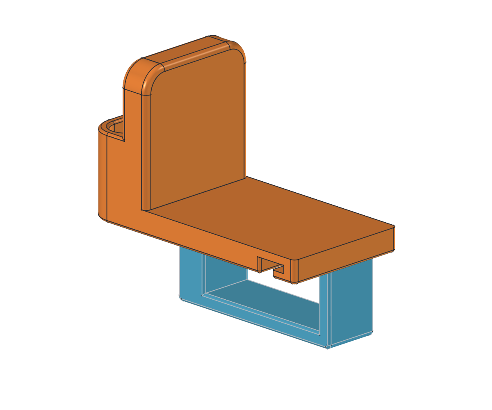
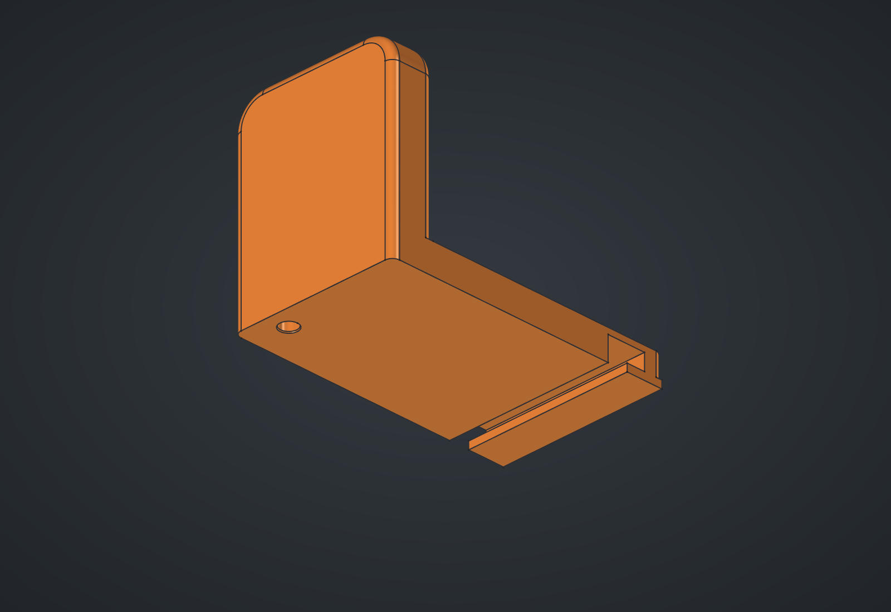

# Крючок для наушников у угла стола

Построено 18.11.2026 **в том же [LaptopDeskMount.FCStd](LaptopDeskMount.FCStd)**,
с существующим окружением и держателями ноутбука. Две нативные редактируемые
детали находятся в группе `HeadphoneHook`: верхняя оранжевая, нижняя голубая.
В FreeCAD оставлен крупный вид правого угла с полупрозрачной столешницей.


Вид с [непрозрачной столешницей](previews/headphone_hook_visible.png)
показывает фактический выступ; [без окружения](previews/headphone_hook_parts.png)
виден узел из двух частей. Оголовье опирается на стол, высота ограничителя
над столешницей — **30 мм**, по последнему указанию пользователя.
Силуэт — смягчённый прямоугольник: плоский верх шириной 34,88 мм,
два верхних угла R10 и кромки R2,5. Полукруглая вершина удалена из истории.
Правый край ограничителя совпадает с правым торцом столешницы: X=350 мм.
Ограничитель занимает X=295,12…350 мм: его левый край совпадает с левым
краем основания, передняя грань со стороны ноутбука совпадает с передней
гранью основания при Y=−14,4 мм. Кольцо полностью удалено из модели.

Низ основной детали выровнен в одну плоскость Z=0,2 мм, выступ под вставкой
удалён. Полка под столешницей — прямоугольная, 54,88 × 93,31 мм, на всю
ширину; задний канал и его удерживающий борт также продолжены до края.
Площадь контакта нижних плоских граней со столом печати — 4725,97 мм².
Скругление задних углов R2 выполняется после добавления удерживающего
бортика и непрерывно проходит по всей высоте 9,91 мм, от Z=0,2 до Z=10,11.
Посадочные плоскости паза зацепа сохранены.



Задача и параметры сохранены в [headphone_hook_plan.json](headphone_hook_plan.json),
исходный рисунок — в [references/headphone_hook_sketch.jpg](references/headphone_hook_sketch.jpg).

## Конструкция

Расположение — **правый угол при взгляде со стороны ноутбука**, то есть
`LegNearRight`, положительный X в существующей модели. Нижний захват
смещается от угла внутрь вдоль перекладины, в сторону отрицательного X.

Две детали из PETG. Верхняя образует небольшой округлый выступ у угла стола
в сторону ноутбука. **Оголовье лежит на
столешнице**, а выступ удерживает наушники от соскальзывания с угла.
Нижняя обхватывает перекладину: сзади входит зацепом в паз верхней,
с другой стороны стягивается скрытым болтом в термовставку верхней детали.
Нижний захват смещён относительно крючка, чтобы обходить вертикальную ногу.

Положение ограничителя и нижнего захвата задаётся отдельно. Нижний обхват
шириной 24 мм расположен за внутренней гранью ноги с зазором 0,4 мм.
После исправления окружения толщина ноги вдоль перекладины — 30,48 мм,
нижний обхват перемещён к ней: X=295,12…319,12 мм, нога начинается при X=319,52 мм.
Задний канал целиком помещается над перекладиной, в зазоре до столешницы.
Зацеп заводится сбоку вдоль перекладины, после чего фиксируется болтом.

Стягивание замыкается через перекладину, контактные поверхности и задний
зацеп. Скруглить корень ограничителя и контактные поверхности. Массу
наушников и ширину оголовья уточнять не требуется при заданном способе
использования. Размеры и положения связаны с таблицей `HookParameters`;
зависимости окружения заданы через прежнюю таблицу `Parameters`.

## Существующее окружение

| Размер | Источник | Как использовать |
|---|---|---|
| Профиль 60,21 × 30,48 мм | Замеры; нога и перекладина одинаковые | Ссылки на `Parameters.BeamWidth/BeamHeight` |
| Ориентация профиля ноги | Подтверждено пользователем | Перекладина: 60,21 по Y × 30,48 по Z; нога: 30,48 по X × 60,21 по Y, как поворот перекладины вниз |
| Зазор 10,51 мм под столешницей | Замер | `Parameters.SpacerHeight` |
| Столешница 25,73 мм | Считывание фото | `Parameters.TabletopThickness` |
| Посадочный зазор 0,4 мм на сторону | Принятый в держателях | Исходный зазор для нового обхвата; отдельно от погрешности замеров |
| Свес 0 мм в обе стороны | Подтверждено пользователем 18.11 | Угол столешницы точно над наружным углом ноги |
| Отступ оси ноги от торца = половина её толщины вдоль X | Следствие совпадения наружных граней | `LegInset = BeamHeight / 2`, сейчас 15,24 мм |
| Ширина стола 700 мм | Условный общий вид | Только размещение; не считать замером |

Мировые координаты существующей модели: X вдоль ближней перекладины,
Y внутрь стола, Z вверх; верх перекладины Z=0. Ноутбук находится со стороны
отрицательного Y. После применения уточнения углы условной столешницы:
X=±350, Y=0 мм; наружные углы ближних ног точно под ними.
Крюк должен крепиться к реальной перекладине, а положение видимого выступа
регулируется относительно реального края. Не подменять условные размеры
точными замерами и не менять проверенную посадку держателей ноутбука.

## Размеры узла

| Размер | Значение, мм |
|---|---:|
| Прямоугольный ограничитель: ширина / толщина / подъём над столом | 54,88 / 14 / 30 |
| Радиус верхних углов / кромок | 10 / 2,5 |
| Верхняя полка в зазоре стола | 9,91 |
| Ширина нижнего захвата / силовая стенка | 24 / 6 |
| Зазор на подтяжку передних стоек | 1,2 |
| Суммарный вертикальный зазор у перекладины | 0,4 |
| Скрытая головка: карман / глубина | Ø7,5 / 22,68 |
| Сквозной проход M4 | Ø4,5 |
| Отверстие для вплавления / глубина | Ø5,6 / 6,4, исходная посадка |

Болт выбран **M4×20**, вставка **M4, наружный Ø6 × длина 6**.
Высота головки болта — 4 мм; это допущение отмечено в параметрах.

## Уточнения крепежа

Пользователь выбрал M4 с цилиндрической головкой и внутренним шестигранником;
диаметр головки принят 7 мм по его опыту. Исходный карман — Ø7,5 мм,
сквозное отверстие — Ø4,5 мм: это выбранные конструктивные зазоры для печати.
Высота головки принята 4 мм. Вставка перенесена в полку: её вход совпадает
с общей нижней плоскостью основной детали. Чтобы сохранить M4×20,
передняя стойка нижнего захвата поднята до Z=−1 мм, а канал головки
углублён до 22,68 мм. Доступ ключа снизу проверен. Номинальное зацепление
со вставкой — 5,8 мм, над вставкой есть запас под
конец болта. Термовставка M4 выбрана с **наружным диаметром 6 мм и длиной 6 мм**.
Наружный диаметр отличается от диаметра отверстия для вплавления.

Под выбранную вставку подготовлен [маленький пробник](exports/headphone_insert_fit_sample.stl)
34 × 14 × 8,5 мм: отверстия **5,4 / 5,6 / 5,8 мм слева направо**, глубина 6,4 мм.
В основной детали сейчас Ø5,6 мм. Пробник позволяет подобрать посадку
под фактическую накатку вставки до печати верхней части.

Первоначально предусмотренное кольцо для джека удалено по просьбе пользователя.
Его операции удалены из истории Body; карман вставки следует сразу за
скруглением ограничителя. Параметр `StopCenterX = CornerX - StopWidth / 2`
задаёт совпадение правого края ограничителя и столешницы. Ширина
`StopWidth = CornerX - ClampX` доводит левый край до края основания;
толщина `StopThickness = BossDepth` совмещает передние грани.

## Исходники и экспорты

[prepare_headphone_hook.py](prepare_headphone_hook.py) проверяет сохранённый
FCStd без FreeCAD в режиме `--check`. Результат:
[headphone_hook_preflight.json](headphone_hook_preflight.json). Геометрическая
проверка выполняется внутри FreeCAD, её результат записан отдельно в
[headphone_hook_validation.json](headphone_hook_validation.json).

Модель уже построена; повторно запускать построение на ней не нужно.
При восстановлении из версии до крючка открыть существующий проект и
последовательно выполнить `prepare_headphone_hook.py`, `build_headphone_hook.py`,
`verify_headphone_hook.py`, затем при необходимости `build_headphone_insert_sample.py`.
Формат запуска каждого файла в консоли FreeCAD:

```python
p = '/home/shved/Projects/3D/Domestic/LaptopDeskMount/build_headphone_hook.py'
exec(compile(open(p).read(), p, 'exec'), {'__file__': p, '__name__': '__main__'})
```

Скрипт сначала исправит прежние условные свес 10 мм и отступ оси ноги 65 мм
на подтверждённые пользователем зависимости: свес 0, отступ оси — половина
толщины ноги вдоль X (30,48 / 2). Профили вертикальных ног развёрнуты
относительно перекладин на 90°; каждая П-образная опора имеет одну
перекладину вдоль ноутбука и две вертикальные стойки. Продольные связи
`LongRailLeft/Right` удалены как отсутствующие в реальном столе.
`build_environment.py` обновлён тем же образом для последующего восстановления
проекта. Эти уточнения уже применены к сохранённому FCStd.

Подготовка добавляет группу, таблицу и два Body. Построение создаёт размерный
эскиз прямоугольной полки, Pad, нативные аддитивные и вычитающие примитивы,
скругления; Python-прокси не используются. В текущей модели высота
доведена до 30 мм, а нижний обхват сдвинут к правильно ориентированной
ноге через таблицу без перестроения истории. Геометрия и путь установки
повторно проверены. Для применения этого обновления к первоначальному
крючку предназначен `refresh_headphone_hook.py`. Прямоугольный верх построен
полной высотой `HookStopStem`, затем следуют `HookStopCorners` (R10)
и `HookStopRim` (R2,5); прежняя операция `HookStopCap` удалена.
`flatten_headphone_hook.py` переводит старую L-образную полку в прямоугольную,
удаляет `HookFrontBoss` и переносит посадку вставки в основную полку.
Он автоматически вызывается из `refresh_headphone_hook.py`.

Готовы [верхний STL](exports/headphone_hook_upper.stl),
[нижний STL](exports/headphone_hook_lower.stl) и соответствующие STEP в
`exports/`. STEP сохраняют положение в сборке. Верхний STL теперь стоит
новым плоским низом на Z=0: 54,88 × 93,31 × 66,04 мм. Нижний сохранён
в ориентации плоскостью X-min вниз: 44,19 × 87,01 × 24 мм.
Нарезка пока не выполнялась; проверить мост в заднем канале длиной
12,6 мм и качество посадочных поверхностей. К каналам есть доступ для
удаления поддержек, если они понадобятся.



Для восстановления крупного вида угла выполнить `view_headphone_hook.FCMacro`.
Исходный проект до добавления крючка сохранён в
`archive/LaptopDeskMount_before_headphone_hook.FCStd`.

## Сборка и печать

Вплавить вставку до установки крюка на стол. Завести верхнюю часть со стороны
ноутбука в зазор над перекладиной. Нижнюю поднять на 28 мм левее окончательного
положения и сдвинуть вправо вдоль перекладины, заводя зацеп в паз.
Затянуть M4×20 снизу. Внутренний проход головки доступен шестиграннику.

Две части заданы разборным креплением к столу: цельный обхват усложнил бы
установку у ноги. Дополнительное дробление крючка пока не требуется.
Основная деталь печатается новым плоским низом вниз, нижний захват —
боковой плоскостью. Поддержки допустимы при доступном удалении; не запирать
их внутри паза или канала головки. Сначала проверить посадочные размеры вставки и
зацепа небольшим образцом, если для них нет проверенной посадки.

Проверено: по одному валидному solid на деталь, замкнутые STL, отсутствие
пересечений в конечном положении и на 119 положениях пути
сборке, свободный доступ инструмента снизу и отсутствие материала за правым
торцом столешницы.
Геометрия обоих проверенных держателей ноутбука не изменилась.
Физическая посадка нового крючка и прочность пока не проверены.
